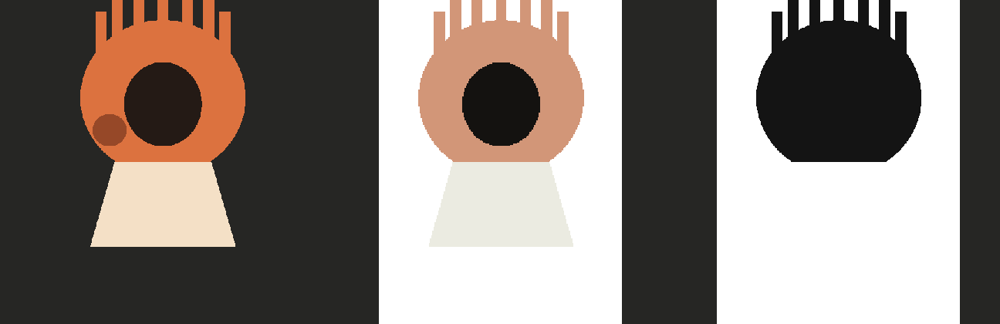

# three-ink-character

**A skill for rendering a character as a print, not as a picture.**

Take a flat-colour character illustration, split it into three ink plates at load time, and re-print
it at any size, any colour state, any registration error and any screen — from code, deterministically.

The character stops being an image and becomes a set of separations. What you get back is the same
figure every time, with a face that never distorts, an outline that stays sharp when it is enlarged
five times, and a set of plates you can shift out of register on purpose.



## Why

An AI image generator gives you a picture: a raster with soft edges, a clean matte you cannot count
on, and colours that drift between one figure and the next. If you animate that raster you get
sprites — resampling artefacts, a face that swims when it scales, nothing that survives a zoom.

If you **separate** it instead, you get something much closer to a print. Three flat inks, hard
edges, cumulative masks. Then:

- the outline can be **traced** into a path, so a close-up is vector-sharp instead of blurry;
- a shifted plate **reveals the ink underneath** instead of cutting a hole, so misregistration
  reads as a press defect rather than a bug;
- a body part (a hand, an ear, a lock of hair) can be **cut out of the plate** and stays in register
  with the figure;
- a screen can ask *which ink is here* rather than *how bright is this pixel*, so halftone and glyph
  treatments keep the separations intact.

The technique, its rules and the project it comes from are described in the upstream repository
[world-execute-me-lyric-mv](https://github.com/Nyankomintsu/world-execute-me-lyric-mv), a
code-rendered lyric video in which the character is a personified Claude printed on every frame.

## Install

Copy the skill folder into wherever your agent looks for skills:

```bash
git clone https://github.com/iamfromchangsha/three-ink-character.git
cp -r three-ink-character/skills/three-ink-character ~/.claude/skills/     # Claude Code
# or: ~/.minimax/skills/                                                     # Mavis
```

There is nothing to install: Node.js 18 or newer, standard library only, no `package.json`, no
dependencies.

## Use it as a tool

```bash
S=skills/three-ink-character/scripts/three-ink.mjs

node $S check    art.png                      # is this source separable at all?
node $S separate art.png --out out/plates     # three cumulative plates + label map + report
node $S print    art.png --out out/print.png  # the figure re-printed in a palette
node $S trace    art.png --out out/figure.svg --ink black
node $S part     art.png --ink cream --seed 290,1100 --out out/hand.png
```

If the generator faked a transparent background — a flat colour, or a grey-and-white checkerboard —
clean the matte before checking:

```bash
node skills/three-ink-character/scripts/clean-matte.mjs raw.png --out clean.png --light-ink cream
```

It recovers the background (measuring the checkerboard period from the image), solves every pixel's
coverage against it, and writes a hard matte (alpha 0 or 255) with flat ink colours. Highlights
enclosed by the figure — catchlights in the eyes — are kept as the light ink.

Quote every hex value, and write roles as `name:#hex`:
`--roles 'cream:#f4e0c4,orange:#db723f,black:#2a1b16'`. An unquoted `#` starts a comment in
PowerShell, and a malformed role is rejected rather than ignored — a typo fails loudly instead of
silently printing the default palette.

`check` is the one to run first. It reports the estimated ink colours, the coverage share of each
ink, the dust in the matte and how much of the figure falls off the three mixing lines — and says
what to change. A source that passes cleanly is worth waiting for; a source that fails will give you
muddy plates no matter what you do downstream.

The plate order is cumulative and load-bearing:

```
plate0_all            the whole figure
plate1_orange_black   orange + black      (print this over plate0)
plate2_black          black               (print this over plate1)
```

Because `plate0 ⊇ plate1 ⊇ plate2`, shifting one plate by a few pixels shows the ink underneath
rather than a hole. That single property is what makes misregistration, and the whole character
animation, work.

## Use it as a skill

The skill folder contains `SKILL.md` plus two references:

- `references/art-spec.md` — how to prompt an image generator for a source this pipeline can
  actually separate: the three-ink rule, matte hygiene, resolution rules for close-ups, registration
  between poses, and the verification loop.
- `references/printing-rules.md` — the print contract: palette roles and what they mean, plate
  order, misregistration, reveal, halftone and glyph screens, the paper, and the rules about faces.


## What is in the box

```
skills/three-ink-character/
├── SKILL.md
├── scripts/
│   ├── three-ink.mjs        separate / check / print / trace / part
│   ├── clean-matte.mjs      recover a faked background, write a hard matte
│   ├── png.mjs              minimal PNG reader + writer, no dependencies
│   └── make-test-image.mjs  synthetic three-ink fixture generator
└── references/
    ├── art-spec.md
    └── printing-rules.md
```

`make-test-image.mjs` writes a synthetic fixture with a clean matte, exactly three inks and one
deliberate fourth tone, so the pipeline can be exercised without shipping anyone's artwork:

```bash
node skills/three-ink-character/scripts/make-test-image.mjs --out demo.png
node skills/three-ink-character/scripts/three-ink.mjs separate demo.png --out out/plates
```

## Licence

MIT — see [`LICENSE`](LICENSE).

The algorithms are derived from
[world-execute-me-lyric-mv](https://github.com/Nyankomintsu/world-execute-me-lyric-mv)
(Copyright © 2026 Nyankomint, MIT); the upstream copyright notice is retained. See
[`NOTICE.md`](NOTICE.md) for what is derived from where.

**No character artwork from the upstream project is included here.** Those silhouettes are CC
BY-NC-SA 4.0 (credit Nyankomint) and are deliberately excluded so this repository stays MIT licensed
and commercially usable.
